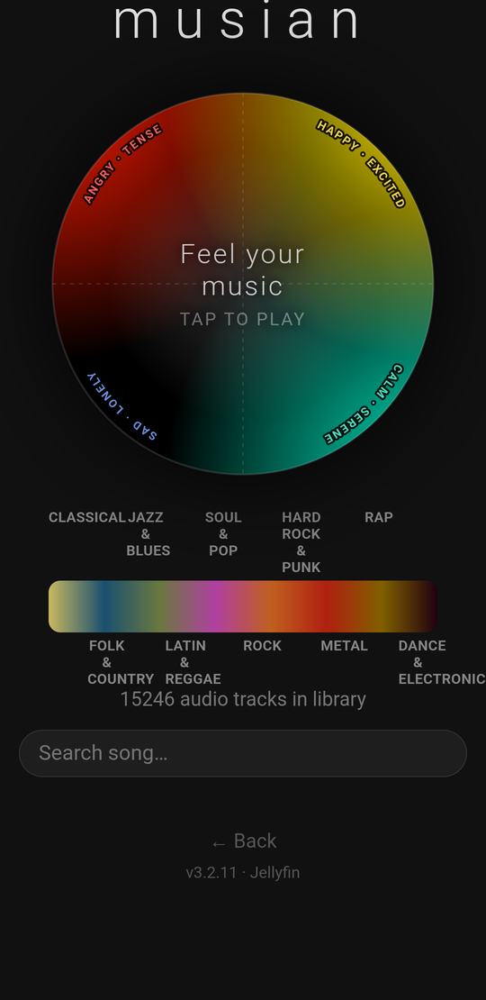
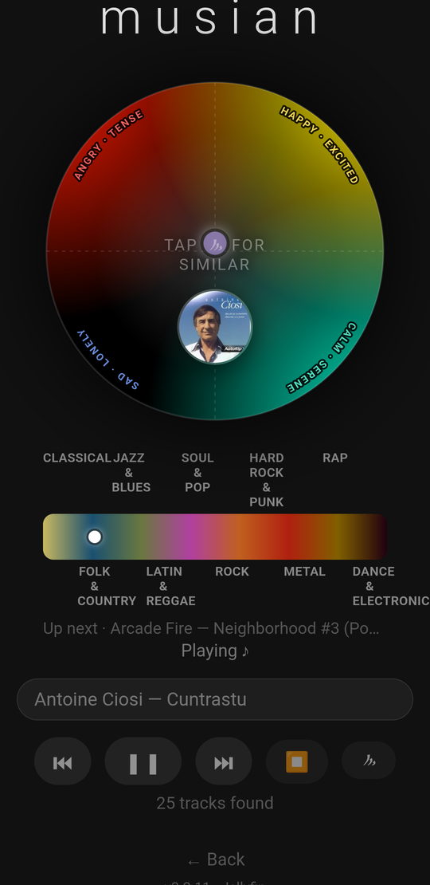

# Musian

Your music, without the scrolling.

Musian is a Jellyfin plugin that adds a mood music player to your server. Instead of picking albums or building playlists, tap the colour wheel and it plays tracks that match, chosen from the genre and mood tags in your files.

It is a third-party plugin: add the repository URL below, it is not in the official Jellyfin catalogue.

<p align="center">
  
  
</p>


## Install

1. Open Jellyfin -> **Dashboard -> Plugins -> Repositories**
2. Click **+** and add this URL:
   ```
   https://ciantm.github.io/jellyfin-plugin-musian/manifest.json
   ```
3. Go to **Catalogue**, search for **Musian**, and install
4. Restart Jellyfin
5. Musian appears in the sidebar for every user of the server

## How the wheel works

Up is high energy, down is low. Right is positive, left is negative. The corners are four moods: Angry and Tense, Happy and Excited, Sad and Lonely, Calm and Serene. Tap near an edge and the genres blend with the neighbouring mood.

## What you get

- Mood wheel: tap a mood, get a queue
- Plays through the Jellyfin player you already use, in the browser and in Jellyfin's mobile apps
- Genre and era filters to narrow a mood
- No account, no analytics, no ads
- Nothing is written to your library, files or tags

## Free

The plugin is free and fully featured. The separate Android app adds background playback, lock-screen controls and Android Auto, and is an optional paid upgrade.

[Get Musian on Google Play](https://play.google.com/store/apps/details?id=com.musian.app)

## Good to know

Mood matching reads the genre and mood tags in your files. A well-tagged library matches better than a sparse one.

Made for people who host their own music.

## Requirements

- Jellyfin **10.9** or later (tested on 12.4)
- Audio tracks with **Genre** tags set in your library

## Development

Publishing a release: bump `version:` in `build.yaml` and `Jellyfin.Plugin.Musian.csproj`, commit and push to `main`. The workflow builds the DLL, creates the release and updates `manifest.json` on GitHub Pages.

Build from source:

```bash
git clone https://github.com/ciantm/jellyfin-plugin-musian.git
cd jellyfin-plugin-musian
dotnet build Jellyfin.Plugin.Musian -c Release
```

Copy the DLL to your Jellyfin plugins folder (`/config/plugins/Musian_1.0.0.0/` in Docker, `~/.local/share/jellyfin/plugins/` on Linux).

## Licence

MIT, see [LICENSE](LICENSE).
